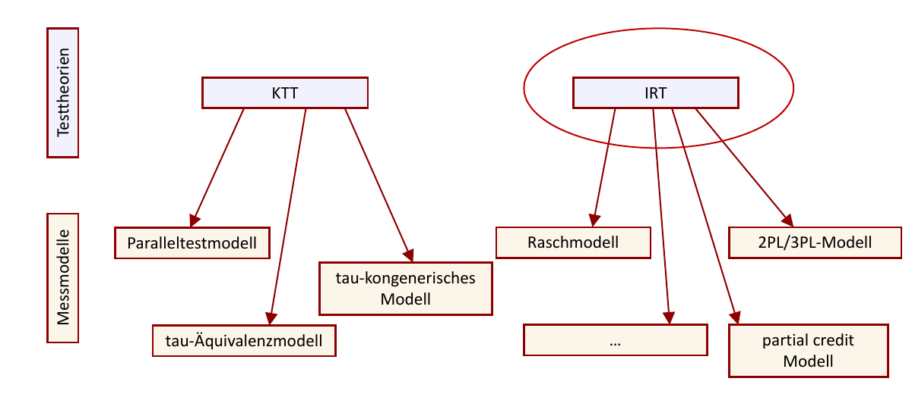
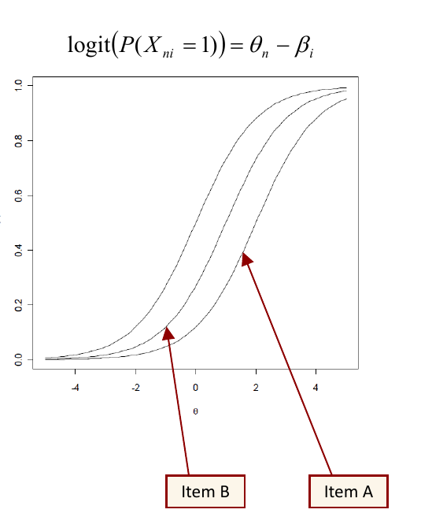

## Modellierung latenter Variablen in Klassischer Testtheorie und Item Response Theory

Sebastian Weirich und Nicklas Hafiz

Institut zur Qualitätsentwicklung im Bildungswesen (IQB)  
Humboldt-Universität zu Berlin

Gesis Workshop, Oktober 2024

## Überblick

1. Messinstrumente und Messmodelle in der Kompetenzdiagnostik
   - Warum braucht man ein Messmodell?

2. Messmodelle werden aus Testtheorien abgeleitet
   - Klassische Testtheorie (KTT)
   - Probabilistische Testtheorie (oder Item Response Theory; IRT)
   - Warum wird in der Kompetenzdiagnostik vorwiegend auf Modelle der IRT anstatt der KTT zurückgegriffen?

3. Verschiedene Modelle der IRT
   - Raschmodell (oder 1PL-Modell)
   - 2PL/3PL-Modelle
   - Partial Credit model (PCM), Generalized Partial Credit model (GPCM)
   - Linear-logistisches Testmodell (LLTM), Multifacettenmodell

## Literatur zur Item Response Theorie

- Embretson, S. E. & Reise, S. P. (2000). *Item response theory for psychologists*. Mahwah, NJ: Erlbaum.
- Hambleton, R. K., Swaminathan, H. & Rogers, H. J. (1991). *Fundamentals of item response theory*. Newbury Park: Sage.
- Kolen, M. J. & Brennan, R. L. (2004). *Testing equating, scaling, and linking: Methods and practice*. New York: Springer.
- Hambleton, R. K., & Jones, R. W. (1993). Comparison of Classical Test Theory and Item Response Theory and Their Applications to Test Development. *Educational Measurement: Issues and Practice*, 38-47.
- Robitzsch, A. (2009). Methodische Herausforderungen bei der Kalibrierung von Leistungstests. In Bremerich-Vos, A., Granzer, D. & Köller, O. (Hrsg.). *Bildungsstandards Deutsch und Mathematik*. S. 42-106. Weinheim: Beltz Pädagogik.
- De Boeck, P. & Wilson, M. (Hrsg.), *Explanatory Item Response Models*. New York: Springer.
- Hedeker, D. Mermelstein, R. & Flay, B. (2006). Application of Item Response Theory Models for Intensive Longitudinal Data. In T. A. Walls & J. L. Schafer (Eds.). *Models for Intensive Longitudinal Data* (pp. 84-108). Oxford University Press, New York.

## Messinstrumente und Messmodelle

- Messen vs. Modellieren: Messen geht der Modellierung voraus
- Messen verlangt ein Messinstrument (aber nicht zwingend ein Messmodell)

→ Messmodelle sind notwendig, wenn die zu messenden Merkmale latent sind

- manifest
  - direkt zu beobachten
  - Messwert = Merkmalswert
  - Beispiele: Körpergröße und -gewicht

- latent
  - nicht direkt zu beobachten
  - hypothetische bzw. theoretisch definierte Konstrukte
  - Messwert ≠ Merkmalswert
  - Beispiele: Intelligenz, Persönlichkeit (“big five”), Depressivität, mathematische Kompetenz
  - Um Aussagen über den Merkmalswert einer Person treffen zu können, muss definiert werden, in welcher Beziehung der Merkmalswert zu den beobachteten Messwerten steht
    - Diese Beziehung wird durch das Messmodell definiert

## Messmodelle werden aus Testtheorien abgeleitet

- Die prominentesten Testtheorien in der Sozial- und Verhaltensforschung sind die klassische Testtheorie (KTT) und die probabilistische Testtheorie (Item Response Theory; IRT)

## KTT vs. IRT

- KTT (“Messfehlertheorie”):
  - Beobachtete Wert = “wahrer Wert” + “individueller Fehler”
  - $Y = \tau + \epsilon$
  - Erwartungswert des Fehlers ist 0
  - Messfehler und tatsächlicher Wert sind unkorreliert

- Bsp. Beck’s Depressions Inventar (BDI)
  - Erfasst den Schweregrad einer (endogenen) Depression
  - 21 Fragen mit jeweils 4 Antwortoptionen, z.B.
    - (0) Ich bin nicht traurig.
    - (1) Ich bin traurig.
    - (2) Ich bin die ganze Zeit traurig und komme nicht davon los.
    - (3) Ich bin so traurig oder unglücklich, dass ich es kaum noch ertrage.
  - Mögliche Summenwerte von minimal 0 bis max. 63 Punkte
    - 0-8: Keine Depression
    - 9-13: Minimale Depression
    - 14-19: Leichte Depression
    - 20-28: Mittelschwere Depression
    - 29-63: Schwere Depression

## KTT vs. IRT

- KTT: Normierung anhand von Vergleichsgruppen (Referenz- oder Normpopulationen)
  - Beurteilung eines spezifischen individuellen Summenwertes (z.B. 37) erfolgt anhand eines Vergleichs mit anderen Personen
  - Problem: Vergleichbarkeit des Testwerts mit dem Testwert eines anderen Depressionstest
  - Voraussetzung: die Verlässlichkeit des Messinstruments ist unabhängig davon
    - wie oft es bereits eingesetzt wurde
    - wie bekannt es ggf. Ist

- Diese Voraussetzungen sind in bestimmten Tests (Leistungs- oder Kompetenztests) möglicherweise nicht gegeben
  - Wenn die Items eines Intelligenz-/Kompetenztests bekannt sind, ist die Güte des Tests eingeschränkt
  - Mögliche Lösung: Paralleltests

## Kompetenztests (z.B. PISA)

- Das Testinstrument wechselt von Jahr zu Jahr (durch Aufgabenveröffentlichung); trotzdem sollen die Ergebnisse jeweils auf derselben Metrik abgebildet werden

- Kompetenzstufenmodelle definieren kriteriale Standards (z.B. Regelstandard). Diese Beschreibungen beziehen sich auf Testaufgaben (Testitems)
  - Die Fähigkeit eines Kindes wird in Relation zur Schwierigkeit von Testaufgaben operationalisiert (vgl. KTT: Die “Fähigkeit” einer Person wird in Relation zur Fähigkeit von Vergleichspopulationen operationalisiert)

- Modelle der klassischen Testtheorie sind nicht geeignet …
  - wenn das Testinstrument sich zwischen Erhebungen verändert, die Skala jedoch gleich bleiben soll
  - wenn Testleistungen nicht nur im Sinne eines “Person X ist besser als Person Y” interpretiert, sondern kriterial beschrieben werden sollen
  - → Diese kriterialen Beschreibungen beziehen sich auf Testitems und erfordern eine Modellierung auf Itemebene

## KTT vs. IRT (Hambleton & Jones, 1993)

| KTT | IRT |
|---|---|
| Vergleicht Personen mit anderen Personen | Vergleicht Personen mit Items |
| Schwache Messmodelle (voraussetzungsarm) | Starke Messmodelle (strikte Voraussetzungen) |
| Item- und Teststatistiken sind stichprobenabhängig | Item- und Teststatistiken sind stichprobenunabhängig: Item- und Personenparameter können auf gemeinsamer Skala abgebildet werden |
| Abhängigkeit der Itemparameter von Stichprobeneigenschaften | Invarianz von Item- und Personenparametern |
| „testbasiert“ | „itembasiert“ |

## Raschmodell: Grundlegende Annahmen

- Raschmodell: einfachstes Modell der IRT
  - Abhängige Variable (AV): Lösungswahrscheinlichkeit $P(X_{ni})$ der Person $n$ für Item $i$
  - nicht die Wahrscheinlichkeit selbst, sondern eine transformierte Wahrscheinlichkeit (“logit”) wird vorhergesagt
    - Warum Transformation? Wahrscheinlichkeitswerte sind auf das Intervall [0, 1] beschränkt und können nicht adäquat linear zerlegt werden. Um lineare Modelle schätzen zu können, muss Transformation erfolgen
    - Logit-Transformation einer Wahrscheinlichkeit $P$: $\operatorname{logit}(P) = \log\left(\frac{P}{1-P}\right)$
    - Wahrscheinlichkeit > 50% führt zu positivem Logit-Wert
      - 75% → logit von 1.09
      - 98% → logit von 3.89
    - Wahrscheinlichkeit < 50% führt zu negativem Logit-Wert
      - 25% → logit von -1.09
      - 5% → logit von -2.94
    - Wahrscheinlichkeit = 50% führt zu Logit = 0
    - Theoretischer Wertebereich des Logits: $-\infty < \operatorname{logit}(P) < +\infty$

## Raschmodell: Grundlegende Annahmen

- Raschmodell: einfachstes Modell der IRT
  - Der Logit der Lösungswahrscheinlichkeit $P(X_{ni})$ schreibt sich $\operatorname{logit}(P(X_{ni} = 1))$ und ist die abhängige Variable (AV) im Raschmodell
  - Im Raschmodell hängt dieser Logit ausschließlich von der Fähigkeit der Person $\theta_n$ und der Schwierigkeit des Items $\beta_i$ ab → $\theta_n$ und $\beta_i$ sind Prädiktoren im Raschmodell

$$
\operatorname{logit}(P(X_{ni} = 1)) = \theta_n - \beta_i
$$

- Eine Person mit der (hypothetischen) Fähigkeit 2 sollte ein Item der Schwierigkeit 2 mit derselben Wahrscheinlichkeit lösen, mit der eine Person der Fähigkeit 1 ein Item der Schwierigkeit 1 löst
  - Schwierigkeit der Items und Fähigkeit der Personen können immer nur in Relation zueinander bestimmt werden
  - Ein konkreter Itemschwierigkeitswert $\beta_i$ ist immer auf eine Personenpopulation bezogen (z.B. die Population der Sekundarschüler der 9. Klasse, die den MSA anstreben)
- setzt man diese Modellbeziehung voraus, können beruhend auf einem Datensatz die Modellparameter (also die Schwierigkeit der Items $\beta_i$ und die Fähigkeit der Personen $\theta_n$) geschätzt werden
- Raschmodell wird auch das einparametrische logistische Modell (1PL) genannt, weil pro Item nur ein Parameter (die Schwierigkeit des Items $\beta_i$) geschätzt wird

## Raschmodell, Annahme 1: parallele Itemcharakteristikkurven

- $\theta_n$: unidimensional latent trait
- Doppelte Monotonizität
  - Rangfolge der Items ist für alle Personen-populationen gleich
  - Rangfolge der Personen ist für alle Item-populationen gleich
  - Beide Annahmen folgen aus der Annahme paralleler Itemcharakteristik-kurven (ICC) im Raschmodell (gleiche Trennschärfe für alle Items)
- Parallele Itemcharakteristikkurven
  - Kurven überschneiden sich nicht
  - Item A ist für jede beliebige Person und in jeder beliebigen Population schwerer als Item B

## Raschmodell, Annahme 2: $\theta_n$ ist unidimensional

- Die Wahrscheinlichkeit $P(X_{ni} = 1)$ wird lediglich durch $\theta_n$ und $\beta_i$ bestimmt
  - das bedeutet, dass sämtliche Items nur zwischen Personen mit unterschiedlichem $\theta_n$ unterscheiden dürfen, nicht etwa zwischen bspw. Personen mit unterschiedlichen Sprachhintergrund etc.
    - Mögliche Verletzung dieser Annahme: Angenommen, zwei Personen mit gleicher (wahrer) Mathematikfähigkeit aber unterschiedlichen Sprachfähigkeiten erreichen einen unterschiedlichen Fähigkeitswert im Mathematiktest
    - Der Test wäre nicht nur nicht “fair”; die Annahmen des Raschmodells wären nicht gegeben, die Parameter des Modells möglicherweise verfälscht

- Alternative: mehrdimensionale Raschmodelle oder Modelle, die Differential Item Functioning (DIF) parametrisieren

- Mehrdimensional: $\operatorname{logit}(P(X_{ni} = 1|\theta)) = \theta - \beta$ mit $\theta = (\theta_1, \theta_2, ..., \theta_D)$

- DIF: $\operatorname{logit}(P(X_{ni} = 1)) = \theta_n - \beta_i + \tau_1 g_j + \tau_2(\beta_i g_j)$

## Raschmodell, Annahme 3: lokale stochastische Unabhängigkeit

- Lokale stochastische Unabhängigkeit
  - Nach Kontrolle der Personenfähigkeit $\theta_n$ existieren keine Beziehungen (= Korrelationen) der Items zueinander mehr
  - Ist äquivalent zur Annahme einer eindimensionalen latenten Fähigkeit (Lord & Novick, 1968)
    - bedeutet praktisch: würde man eine Gruppe von Personen mit identischer Fähigkeit einen Test bearbeiten lassen, wären ihre Antworten nicht korreliert

- Weswegen überhaupt diese Annahme?
  - Parameterschätzung erfolgt in Marginal Maximum Likelihood Estimation (Adams & Wu, 1997)

Then the likelihood for a set of $N$ response patterns is

$$
\Lambda(\xi, \alpha|X) =
\prod_{j=1}^{N}
\int_{\Theta}
\Psi(\theta, \xi)
\exp\left[x'_j(B\theta + A\xi)\right]
dG(\theta; \alpha) .
\qquad (14)
$$

- Die Wahrscheinlichkeit eines Antwortmusters einer Person wird über das Produkt der Einzelwahrscheinlichkeiten bestimmt. Das ist nur zulässig, wenn die Einzelereignisse (= einzelnen Antworten) zueinander unabhängig sind

## Alternative: Modelle, die lokale Abhängigkeiten parametrisieren

- Modelle zur Behandlung lokaler Abhängigkeit
  - Copula-Modelle (Braeken, 2011; Braeken, Tuerlinckx & de Boeck, 2007)
  - Marginale Modelle für stochastische Abhängigkeit (Tuerlinckx & de Boeck, 2004)
  - Explanatorische Item-Response-Modelle (Wilson & De Boeck, 2004)

- Problem: Interpretierbarkeit
  - Parameter aus Modellen für stochastische Abhängigkeit können nicht mehr als Itemschwierigkeitsparameter interpretiert werden (Tuerlinckx & de Boeck, 2004)
  - „Second, the parameter $\beta_2$ does not have the natural interpretation of marking the point on the latent scale where the probability of a correct response is .5. […] The parameters pertaining to a single item cannot be seen as item difficulties“ (Tuerlinckx & de Boeck, 2004, S. 307)
  - Je einfacher das Modell ist, desto besser und intuitiver lassen sich die Parameter interpretieren und verstehen. Aber: umso unwahrscheinlicher ist ggf. die Gültigkeit/Verlässlichkeit des Modells
  - “All models are wrong but some are useful” (Box & Draper, 1987; S. 74)
  - Wie findet man den besten Kompromiss zwischen Modellpassung und Interpretierbarkeit?

## Zusammenfassung

- Warum überhaupt Messmodelle?
  - Die zu messenden Merkmale sind latent, nicht direkt zu beobachten

- Warum Messmodelle der Item-Response-Theorie?
  - Gemeinsame Skala für Items und Personen
  - Vergleichbare Metrik trotz immer wieder neu entwickelter Tests/Aufgaben
  - Stichprobenunabhängige (Item-)Parameter

- Warum ein möglichst einfaches IRT-Modell?
  - Eigenschaft der parallelen Item-Response-Kurven günstig für die Interpretation in und die Konstruktion von Kompetenzstufenmodellen
  - Itemparameter können als Itemschwierigkeit interpretiert und direkt in erwartete Lösungswahrscheinlichkeiten “übersetzt” werden
  - → Einfache/intuitive Interpretierbarkeit der Ergebnisse
